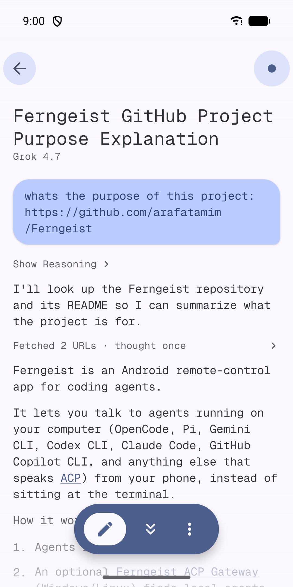
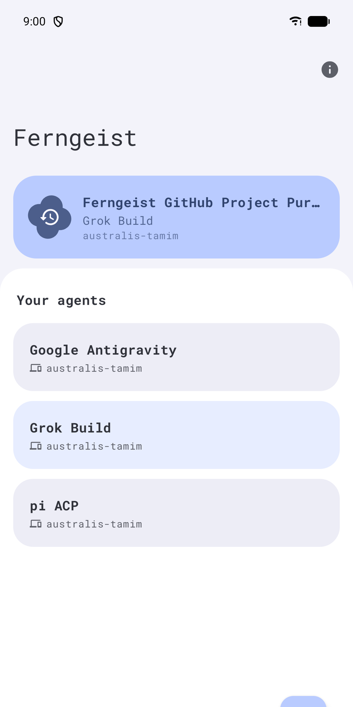
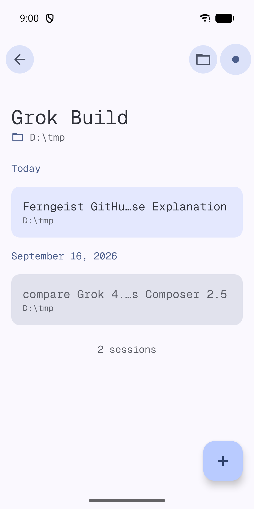
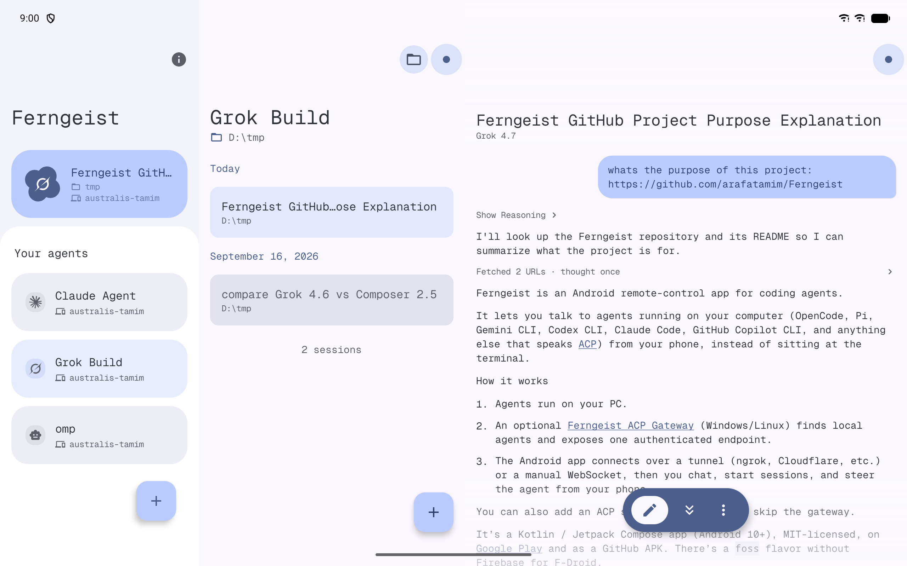
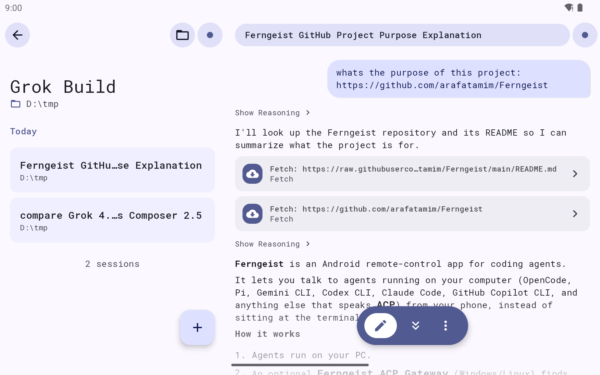
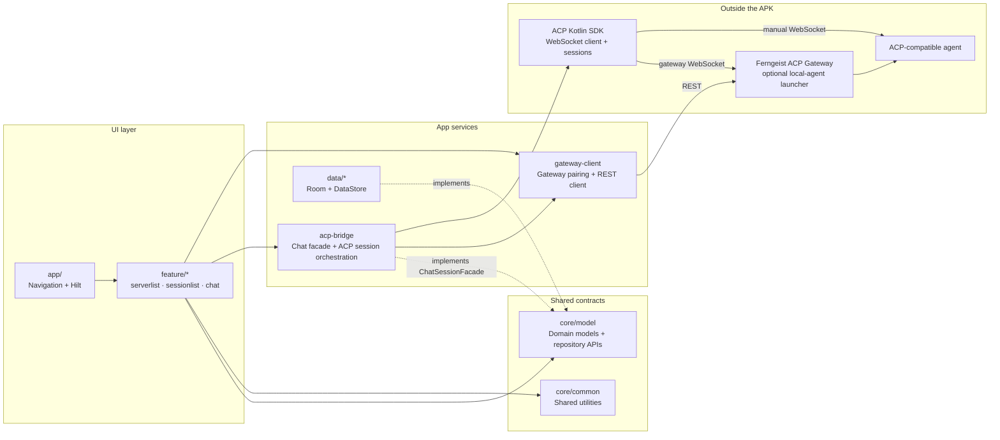

# Ferngeist

**Your coding agents, in your pocket.**

Run Claude Code, Codex, Gemini CLI or another coding agent on your computer and drive it from your Android phone or tablet. Start a task from the couch, and Ferngeist notifies you when the agent finishes.

[](https://opensource.org/licenses/MIT)
[](https://github.com/arafatamim/ferngeist/releases/latest)
[](https://deepwiki.com/arafatamim/Ferngeist)

<a href="https://play.google.com/store/apps/details?id=com.tamimarafat.ferngeist"></a>

Or grab the APK from [GitHub Releases](https://github.com/arafatamim/ferngeist/releases/latest) (no auto-updates). Requires Android 11 or later.



https://github.com/user-attachments/assets/9af837d6-a901-493b-827e-93a3fdb1aa24

## Why Ferngeist

- **Leave your desk.** Your agent keeps working on your computer, and Ferngeist notifies you when it finishes or needs an answer.
- **Review the work on your phone.** You read the agent's messages, reasoning, tool calls and code diffs in a layout sized for a small screen.
- **Keep going on a bad connection.** Lose signal on the train and Ferngeist reconnects the session where it left off.
- **Bring the agent you already use.** Works with any agent that speaks the [Agent Client Protocol](https://agentclientprotocol.com/), including Claude Code, Codex CLI, Gemini CLI, GitHub Copilot CLI and OpenCode ([full list](https://agentclientprotocol.com/get-started/agents)).
- **Phones, foldables and tablets.** Ferngeist shows one pane on a phone, two on a small tablet and three on a large one.
- **Free and open source.** Ferngeist is MIT licensed, needs no account and runs no servers of its own. The app talks to the machines you connect it to and nothing else. Details are in the [Privacy Policy](docs/privacy_policy.md).

## Get started in 3 steps

You'll need the free [Ferngeist Gateway](https://github.com/arafatamim/ferngeist-acp-gateway) on your computer (Windows, macOS or Linux). It finds the agents you have installed and gives your phone one secure address to reach them.

**1. Install the gateway**

```powershell
# Windows (PowerShell)
irm https://arafatamim.github.io/ferngeist-acp-gateway/install.ps1 | iex
```

```bash
# macOS / Linux
curl -fsSL https://arafatamim.github.io/ferngeist-acp-gateway/install.sh | sh
```

Packages for a manual install are on the [gateway releases page](https://github.com/arafatamim/ferngeist-acp-gateway/releases/latest).

**2. Reach it from anywhere** (optional)

The installer starts the gateway on your local network, so a phone on the same Wi-Fi can already connect. To reach it from outside your home, switch it to remote access:

```bash
ferngeist-gateway daemon install --remote # run as Administrator on Windows
```

This command sets up a Tailscale Funnel and prints a stable HTTPS address. The first run also prints a Tailscale login link (a free account is enough).

**3. Pair your phone**

```bash
ferngeist-gateway pair
```

In Ferngeist, tap **Add server**, then enter the gateway address (the HTTPS address from step 2, or your computer's address on Wi-Fi) and the pairing code. Your agents appear in the app.

<details>
<summary><b>Use your own tunnel instead of Tailscale</b></summary>

The gateway listens on port `5788`. Point a tunnel at that port and pass its URL with `--public-url`.

**ngrok**

```bash
ngrok http 5788
ferngeist-gateway daemon install --public-url https://xxxx.ngrok.io
```

**Cloudflare Tunnel**

```bash
cloudflared tunnel --url http://localhost:5788
ferngeist-gateway daemon install --public-url https://xxxx.trycloudflare.com
```

A custom domain works the same way: `--public-url https://your.domain.example`.
</details>

<details>
<summary><b>Connect to an ACP server without the gateway</b></summary>

If you already run an ACP agent over WebSocket, add it directly. Most agents talk over `stdio`, so wrap yours in a WebSocket bridge first. The agent's docs list the flag that starts it in ACP mode:

```powershell
npx -y stdio-to-ws "npx @qwen-code/qwen-code@latest --acp" --port 8769
```

Then add `ws://<your-pc-ip>:8769` in Ferngeist as the server host.
</details>

More options are in the [gateway docs](https://github.com/arafatamim/ferngeist-acp-gateway).

## Screenshots

 

*Your agents, and the sessions you've had with each one.*



*On a tablet, agents, sessions and chat sit side by side.*



## FAQ

**Does my code leave my computer?** Ferngeist sends your prompts to the agent on your computer and shows its replies. Your agent still sends code to its model provider, as it does when you sit at your desk.

**Do I need Tailscale?** No. Tailscale is the quickest option, and any HTTPS tunnel or your own domain works too.

**Is there a build without Google services?** Yes. The `foss` build drops ML Kit and Play Services; push notifications then need a [UnifiedPush](https://unifiedpush.org) app such as ntfy.

**Found a bug or want a feature?** Open an issue on [GitHub](https://github.com/arafatamim/ferngeist/issues).

## For developers

### Tech Stack

- Kotlin 2.4 / Jetpack Compose + Material 3
- Hilt / Room / Kotlin Coroutines and Flow / KSP
- ACP Kotlin SDK

### Build

Install [JDK 21](https://adoptium.net/temurin/releases/?version=21) for Gradle
and tests, matching CI and the diff library's Java 21 bytecode. The daemon JVM
criteria require a locally installed JDK 21; automatic download is not configured.
Set `JAVA_HOME` to that JDK as well so the Gradle launcher
uses the same runtime. On Linux, `./scripts/gradle-safe` caps the whole build
at 4 GiB and runs one worker at a time.

The app has two product flavours under the `distribution` dimension:

- `google`: the full build with ML Kit QR scanning. It ships to Google
  Play and GitHub releases. Push notifications arrive through a
  [UnifiedPush](https://unifiedpush.org) distributor if you have one (e.g. ntfy),
  otherwise through Google Play Services. No Firebase project is involved.
- `foss`: a Fully Open-Source Software build for F-Droid. It omits ML Kit, so you
  type the pairing code instead of scanning a QR code, and it has no Play Services
  fallback: **push notifications need a UnifiedPush distributor app** such as ntfy.
  Without one the agent keeps running on your gateway, but you get no notification
  when it finishes.

```powershell
cmd /c gradlew.bat :app:assembleGoogleDebug
```

### Architecture



**Key data flow:**
1. `app/` owns navigation and Hilt bindings, then routes users into the feature modules.
2. Feature modules render Compose UI and depend on `core/model` contracts instead of persistence details.
3. `data/*` provides the local Room/DataStore implementations for saved servers, gateway bindings, and preferences.
4. `acp-bridge` implements `ChatSessionFacade`, manages ACP connections/sessions, and converts SDK callbacks into app events.
5. `gateway-client` handles pairing and gateway REST calls; the bridge uses it when a chat starts from a gateway-backed agent.
6. Manual servers connect directly to an ACP agent through the SDK, while gateway-backed agents go through the optional Ferngeist ACP Gateway first.

### Project Structure

```
app/                  Android entry point, navigation, theme, DI
acp-bridge/           ACP transport, connection manager, session bridge
core/common/          Shared UI helpers and utilities
core/model/           Domain models and repository interfaces
data/database/        Room database, DAOs, entities
feature/serverlist/   Saved server management UI
feature/sessionlist/  Session listing and creation
feature/chat/         Streaming chat UI, reducers, markdown state
gateway-client/       Ferngeist ACP Gateway HTTP client
gradle/               Version catalog
```

## License

MIT. See [LICENSE](LICENSE).
